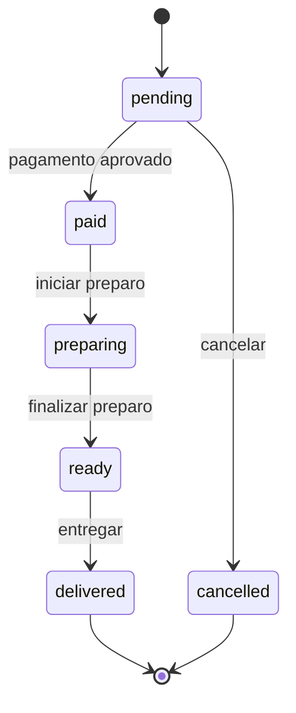

# FoodOrder
Sistema web de gerenciamento de pedidos de uma lanchonete.

Projeto acadêmico (disciplina Padrões de Projeto em Engenharia de Software): monólito Laravel 12 / PHP 8.4 com Blade, Bootstrap 5 e SQLite, executado em Docker.

> Aplicação de demonstração sem autenticação, destinada a execução local ou rede privada controlada.

## Requisitos

- Docker Engine e Docker Compose v2. Nenhum PHP, Composer ou Node é necessário no host.
- Linux/macOS, ou Windows via WSL2/Git Bash.

## Ambiente de desenvolvimento

```bash
cp .env.example .env
docker compose run --rm --no-deps app php artisan key:generate --show
# copie a chave exibida para APP_KEY no .env
docker compose up --build -d
```

A aplicação fica em `http://localhost:8080` (porta e endereço configuráveis por `DEV_PORT` e `DEV_BIND_ADDRESS` no `.env`; por padrão publica apenas em `127.0.0.1`). Se a porta 8080 já estiver em uso, altere `DEV_PORT` e `APP_URL` no `.env` antes do `up`.

Na inicialização o container verifica as guardas de ambiente (`APP_ENV=local` e ausência da marca de produção), sincroniza o `vendor` com o `composer.lock` (sem `composer update`), cria o arquivo SQLite se necessário, executa as migrations de forma segura e roda o seed idempotente do catálogo (`CatalogSeeder`: cria apenas os produtos ausentes, sem duplicar nem sobrescrever dados existentes). A `APP_KEY` nunca é gerada ou regenerada automaticamente.

### Comandos úteis

```bash
docker compose ps
docker compose logs -f app
docker compose exec app php artisan test
docker compose exec app php artisan route:list
docker compose exec app vendor/bin/pint --test
docker compose down
```

`docker compose down` preserva os volumes (`sqlite_data` e `vendor_data`). `docker compose down -v` apaga os dados de desenvolvimento e só deve ser usado deliberadamente.

### Cardápio

`GET /` lista os produtos ativos (hambúrguer R$ 20,00, cachorro-quente R$ 15,00 e batata frita R$ 10,00); sem produtos ativos exibe uma mensagem. Para repetir o seed manualmente: `docker compose exec app php artisan db:seed` (idempotente).

### Pedidos e padrão Decorator

Na página do cardápio, **Fazer pedido** abre `GET /orders/create?product_id=...`; o formulário (`POST /orders`) permite escolher complementos e, ao confirmar, redireciona para o detalhe `GET /orders/{id}`. O pedido nasce `pending`; preço, descrição e estado são sempre calculados no servidor (valores enviados pelo navegador são ignorados).

- Complementos (fonte única em `config/foodorder.php`): Bacon R$ 4,00, Queijo extra R$ 3,00 e Ovo R$ 2,00, para hambúrguer e cachorro-quente; batata frita não aceita complementos; cada complemento no máximo uma vez.
- **Problema:** combinar complementos sem criar uma subclasse para cada combinação. **Decorator** (`app/Patterns/Decorator/`): `MenuItem` (Component), `BaseMenuItem` (Concrete Component), `MenuItemDecorator` (Decorator) e `BaconDecorator`, `CheeseDecorator`, `EggDecorator` (Concrete Decorators). `OrderService` encadeia os decorators e o subtotal e a descrição do pedido vêm dessa composição.
- **Demonstração:** crie um Hambúrguer com Bacon e Queijo extra: subtotal R$ 27,00 e descrição "Hambúrguer + Bacon + Queijo extra". Os testes `tests/Unit/Decorator/MenuItemDecoratorTest.php` mostram o encadeamento e a delegação.
- O pedido guarda snapshots (nome do produto e complementos com preços); mudanças posteriores no catálogo não o alteram.

### Cálculo de pagamento e padrão Strategy

- **Problema:** o valor final depende do método de pagamento (PIX com 5% de desconto, cartão e dinheiro sem desconto, dinheiro com troco) e esses cálculos não ficam concentrados em um `switch`.
- **Strategy** (`app/Patterns/Strategy/`): `PaymentStrategy` (Strategy, `calculate(int $subtotalCents, ?int $receivedCents): PaymentQuote`), `PixPaymentStrategy`, `CardPaymentStrategy` e `CashPaymentStrategy` (Concrete Strategies), `PaymentCalculator` (Context, apenas seleciona a estratégia do método e delega) e `PaymentQuote` (resultado imutável: subtotal, desconto, total, valor recebido e troco, em centavos).
- **Regras:** PIX = `intdiv(subtotal * 95 + 50, 100)` (meio centavo arredonda para cima, ex.: 2010 → 1910); cartão = subtotal; dinheiro = subtotal, exige valor recebido suficiente e calcula o troco. Métodos desconhecidos, subtotal negativo e valor recebido ausente, negativo ou insuficiente são rejeitados (`InvalidPaymentException`). Tudo em inteiros, sem `float`.
- **Integração:** `PaymentService` reutiliza o `PaymentCalculator` para obter o total; calcular uma cotação por si só não altera o pedido nem grava nada.
- **Demonstração:** `docker compose exec app php artisan test --filter=Strategy` e `--filter=PaymentCalculator`. Para o subtotal 2700 do exemplo do Decorator: PIX = 2565, cartão = 2700, dinheiro (recebido 3000) = 2700 com troco 300.
- **Papéis distintos:** Decorator compõe o subtotal do pedido; Strategy calcula as condições de pagamento sobre esse subtotal persistido; o **Adapter** isola os gateways simulados (seção abaixo).

### Pagamento simulado, Adapter e State inicial

> **Pagamento simulado — nenhuma cobrança real é realizada.** Não há rede, SDK financeiro, dados de cartão, conta bancária ou chave PIX.

No detalhe de um pedido `pending` há o formulário de pagamento (`POST /orders/{order}/pay`): escolha **PIX** (5% de desconto), **cartão** (valor integral) ou **dinheiro** (informe o valor recebido em reais, ex.: `30,00`; o troco é calculado). Para um pedido de R$ 27,00: PIX = R$ 25,65; cartão = R$ 27,00; dinheiro com R$ 30,00 = R$ 27,00 e troco R$ 3,00. Aprovado, o pedido vira `paid` e o detalhe mostra método, desconto, total, recebido, troco e a referência fictícia (`SIMULATED-...`). Rejeições (gateway, dinheiro insuficiente, método inválido) mantêm o pedido `pending` e permitem nova tentativa; um segundo pagamento é recusado antes de chamar o gateway.

- **Problema do Adapter:** dois "gateways legados" têm contratos incompatíveis: `LegacyPixGateway::sendPix(int $amountCents): array` (ex.: `['status' => 'CONFIRMED', 'txid' => 'SIMULATED-PIX-...', 'amount_cents' => 2565]`) e `LegacyCardGateway::charge(string $amountDecimal): string` (ex.: `"APPROVED|SIMULATED-CARD-...|27.00"`).
- **Participantes** (`app/Patterns/Adapter/`): `PaymentGateway` (Target, `charge(int $totalCents): PaymentResult`), `LegacyPixGateway` e `LegacyCardGateway` (Adaptees, não modificados), `PixGatewayAdapter` e `CardGatewayAdapter` (Adapters: convertem centavos em decimal com inteiros, ex.: `2565` → `"25.65"`, e traduzem a resposta legada; respostas inesperadas nunca são aprovação), `CashPaymentGateway` (implementa o Target diretamente: dinheiro não tem API incompatível) e `PaymentResult` (aprovado + referência, ou rejeitado + erro).
- **Integração dos padrões:** Decorator → subtotal persistido do pedido; Strategy (`PaymentCalculator`) → cotação; Adapter (`PaymentGateway`) → processamento simulado; State → elegibilidade e transição `pending → paid`; tudo coordenado por `PaymentService` em uma única transação.
- **State:** o pagamento usa o State para verificar a elegibilidade antes do gateway e para a transição `pending → paid` (detalhes na seção seguinte).
- **Concorrência (SQLite):** o pagamento roda em transação `BEGIN IMMEDIATE` (`transaction_mode` em `config/database.php`, com `busy_timeout`), relê o pedido dentro do lock e `payments.order_id` é `UNIQUE`. O teste `PaymentConcurrencyTest` usa dois processos PHP reais sobre um SQLite temporário.
- **Demonstração:** `docker compose exec app php artisan test --filter=Adapter`, `--filter=PaymentService` e `--filter=PaymentConcurrency`.

### Ciclo de vida do pedido e padrão State

- **Problema:** as operações permitidas dependem do estado do pedido (não se cancela um pedido pago, não se entrega um pedido pendente, pedidos entregues/cancelados não mudam mais) e isso não fica espalhado em `if`/`switch`.
- **Participantes** (`app/Patterns/State/`): `Order` (Context; `state()` reidrata a classe a partir do status persistido e `transitionTo()` aplica a transição), `OrderState` (State: `pay`, `start`, `ready`, `deliver`, `cancel`, mais `can*` derivados), `AbstractOrderState` (rejeita tudo por padrão com `InvalidOrderTransitionException`) e os estados concretos `PendingState`, `PaidState`, `PreparingState`, `ReadyState`, `DeliveredState` e `CancelledState`. `OrderStatus` apenas nomeia os valores persistidos. As operações dos estados são puras (devolvem o próximo estado ou lançam exceção); `PaymentService` e `OrderLifecycleService` abrem a transação, relêem o pedido e aplicam o resultado.
- **Rotas:** `POST /orders/{order}/pay|start|ready|deliver|cancel`. O detalhe do pedido mostra só as ações permitidas, mas o backend rejeita qualquer POST inválido.



- **Demonstração do ciclo completo:** crie um pedido, pague (PIX, cartão ou dinheiro), depois use **Iniciar preparo**, **Finalizar preparo** e **Entregar pedido**. **Cancelamento:** em um pedido pendente use **Cancelar pedido**; depois disso (ou após o pagamento) qualquer cancelamento, pagamento ou avanço é rejeitado com mensagem, sem alterar dados.
- **Testes:** `docker compose exec app php artisan test --filter=OrderState` (matriz de 30 combinações e reidratação), `--filter=OrderLifecycle` (serviço, HTTP e concorrência).
- Decorator compõe o subtotal, Strategy calcula o pagamento, Adapter processa o gateway simulado e State controla as transições. Histórico de transições e notificações (Observer) **ainda não** foram implementados.

### Dados e testes

- O banco SQLite fica no volume `sqlite_data` (`/data/database.sqlite`), separado do código.
- Os testes usam `APP_ENV=testing` e SQLite `:memory:` (forçados em `phpunit.xml`), sem tocar o banco de desenvolvimento.
- Bootstrap 5 é servido localmente em `public/vendor/bootstrap` (licença MIT incluída); não há Node, Vite nem CDN.

## Documentação de desenvolvimento

O contexto e o histórico locais de desenvolvimento ficam em `context/`, pasta ignorada pelo Git e excluída do contexto de build do Docker.
