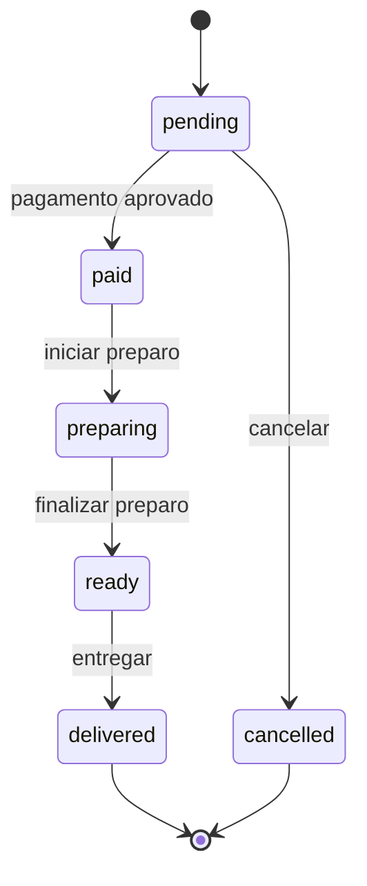
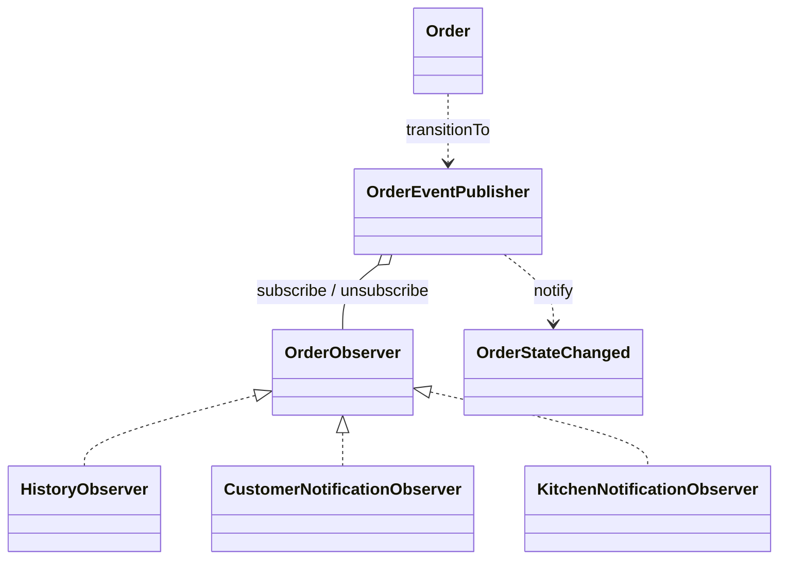
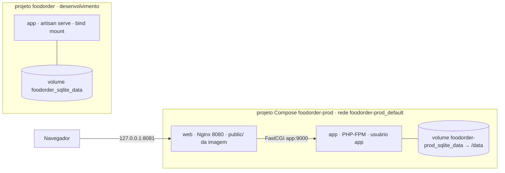

# FoodOrder
Sistema web de gerenciamento de pedidos de uma lanchonete.

Projeto acadêmico (disciplina Padrões de Projeto em Engenharia de Software): monólito Laravel 12 / PHP 8.4 com Blade, Bootstrap 5 e SQLite, executado em Docker.

> Aplicação de demonstração sem autenticação, destinada a execução local ou rede privada controlada.

## Requisitos

- Docker Engine e Docker Compose v2. Nenhum PHP, Composer ou Node é necessário no host.
- Linux/macOS, ou Windows via WSL2/Git Bash.

## Ambiente de desenvolvimento

```bash
cp .env.example .env
docker compose run --rm --no-deps app php artisan key:generate --show
# copie a chave exibida para APP_KEY no .env
docker compose up --build -d
```

A aplicação fica em `http://localhost:8080` (porta e endereço configuráveis por `DEV_PORT` e `DEV_BIND_ADDRESS` no `.env`; por padrão publica apenas em `127.0.0.1`). Se a porta 8080 já estiver em uso, altere `DEV_PORT` e `APP_URL` no `.env` antes do `up`.

Na inicialização o container verifica as guardas de ambiente (`APP_ENV=local` e ausência da marca de produção), sincroniza o `vendor` com o `composer.lock` (sem `composer update`), cria o arquivo SQLite se necessário, executa as migrations de forma segura e roda o seed idempotente do catálogo (`CatalogSeeder`: cria apenas os produtos ausentes, sem duplicar nem sobrescrever dados existentes). A `APP_KEY` nunca é gerada ou regenerada automaticamente.

### Comandos úteis

```bash
docker compose ps
docker compose logs -f app
docker compose exec app php artisan test
docker compose exec app php artisan route:list
docker compose exec app vendor/bin/pint --test
docker compose down
```

`docker compose down` preserva os volumes (`sqlite_data` e `vendor_data`). `docker compose down -v` apaga os dados de desenvolvimento e só deve ser usado deliberadamente.

### Cardápio

`GET /` lista os produtos ativos (hambúrguer R$ 20,00, cachorro-quente R$ 15,00 e batata frita R$ 10,00); sem produtos ativos exibe uma mensagem. Para repetir o seed manualmente: `docker compose exec app php artisan db:seed` (idempotente).

### Pedidos e padrão Decorator

Na página do cardápio, **Fazer pedido** abre `GET /orders/create?product_id=...`; o formulário (`POST /orders`) permite escolher complementos e, ao confirmar, redireciona para o detalhe `GET /orders/{id}`. O pedido nasce `pending`; preço, descrição e estado são sempre calculados no servidor (valores enviados pelo navegador são ignorados).

- Complementos (fonte única em `config/foodorder.php`): Bacon R$ 4,00, Queijo extra R$ 3,00 e Ovo R$ 2,00, para hambúrguer e cachorro-quente; batata frita não aceita complementos; cada complemento no máximo uma vez.
- **Problema:** combinar complementos sem criar uma subclasse para cada combinação. **Decorator** (`app/Patterns/Decorator/`): `MenuItem` (Component), `BaseMenuItem` (Concrete Component), `MenuItemDecorator` (Decorator) e `BaconDecorator`, `CheeseDecorator`, `EggDecorator` (Concrete Decorators). `OrderService` encadeia os decorators e o subtotal e a descrição do pedido vêm dessa composição.
- **Demonstração:** crie um Hambúrguer com Bacon e Queijo extra: subtotal R$ 27,00 e descrição "Hambúrguer + Bacon + Queijo extra". Os testes `tests/Unit/Decorator/MenuItemDecoratorTest.php` mostram o encadeamento e a delegação.
- O pedido guarda snapshots (nome do produto e complementos com preços); mudanças posteriores no catálogo não o alteram.

### Cálculo de pagamento e padrão Strategy

- **Problema:** o valor final depende do método de pagamento (PIX com 5% de desconto, cartão e dinheiro sem desconto, dinheiro com troco) e esses cálculos não ficam concentrados em um `switch`.
- **Strategy** (`app/Patterns/Strategy/`): `PaymentStrategy` (Strategy, `calculate(int $subtotalCents, ?int $receivedCents): PaymentQuote`), `PixPaymentStrategy`, `CardPaymentStrategy` e `CashPaymentStrategy` (Concrete Strategies), `PaymentCalculator` (Context, apenas seleciona a estratégia do método e delega) e `PaymentQuote` (resultado imutável: subtotal, desconto, total, valor recebido e troco, em centavos).
- **Regras:** PIX = `intdiv(subtotal * 95 + 50, 100)` (meio centavo arredonda para cima, ex.: 2010 → 1910); cartão = subtotal; dinheiro = subtotal, exige valor recebido suficiente e calcula o troco. Métodos desconhecidos, subtotal negativo e valor recebido ausente, negativo ou insuficiente são rejeitados (`InvalidPaymentException`). Tudo em inteiros, sem `float`.
- **Integração:** `PaymentService` reutiliza o `PaymentCalculator` para obter o total; calcular uma cotação por si só não altera o pedido nem grava nada.
- **Demonstração:** `docker compose exec app php artisan test --filter=Strategy` e `--filter=PaymentCalculator`. Para o subtotal 2700 do exemplo do Decorator: PIX = 2565, cartão = 2700, dinheiro (recebido 3000) = 2700 com troco 300.
- **Papéis distintos:** Decorator compõe o subtotal do pedido; Strategy calcula as condições de pagamento sobre esse subtotal persistido; o **Adapter** isola os gateways simulados (seção abaixo).

### Pagamento simulado, Adapter e State inicial

> **Pagamento simulado — nenhuma cobrança real é realizada.** Não há rede, SDK financeiro, dados de cartão, conta bancária ou chave PIX.

No detalhe de um pedido `pending` há o formulário de pagamento (`POST /orders/{order}/pay`): escolha **PIX** (5% de desconto), **cartão** (valor integral) ou **dinheiro** (informe o valor recebido em reais, ex.: `30,00`; o troco é calculado). Para um pedido de R$ 27,00: PIX = R$ 25,65; cartão = R$ 27,00; dinheiro com R$ 30,00 = R$ 27,00 e troco R$ 3,00. Aprovado, o pedido vira `paid` e o detalhe mostra método, desconto, total, recebido, troco e a referência fictícia (`SIMULATED-...`). Rejeições (gateway, dinheiro insuficiente, método inválido) mantêm o pedido `pending` e permitem nova tentativa; um segundo pagamento é recusado antes de chamar o gateway.

- **Problema do Adapter:** dois "gateways legados" têm contratos incompatíveis: `LegacyPixGateway::sendPix(int $amountCents): array` (ex.: `['status' => 'CONFIRMED', 'txid' => 'SIMULATED-PIX-...', 'amount_cents' => 2565]`) e `LegacyCardGateway::charge(string $amountDecimal): string` (ex.: `"APPROVED|SIMULATED-CARD-...|27.00"`).
- **Participantes** (`app/Patterns/Adapter/`): `PaymentGateway` (Target, `charge(int $totalCents): PaymentResult`), `LegacyPixGateway` e `LegacyCardGateway` (Adaptees, não modificados), `PixGatewayAdapter` e `CardGatewayAdapter` (Adapters: convertem centavos em decimal com inteiros, ex.: `2565` → `"25.65"`, e traduzem a resposta legada; respostas inesperadas nunca são aprovação), `CashPaymentGateway` (implementa o Target diretamente: dinheiro não tem API incompatível) e `PaymentResult` (aprovado + referência, ou rejeitado + erro).
- **Integração dos padrões:** Decorator → subtotal persistido do pedido; Strategy (`PaymentCalculator`) → cotação; Adapter (`PaymentGateway`) → processamento simulado; State → elegibilidade e transição `pending → paid`; tudo coordenado por `PaymentService` em uma única transação.
- **State:** o pagamento usa o State para verificar a elegibilidade antes do gateway e para a transição `pending → paid` (detalhes na seção seguinte).
- **Concorrência (SQLite):** o pagamento roda em transação `BEGIN IMMEDIATE` (`transaction_mode` em `config/database.php`, com `busy_timeout`), relê o pedido dentro do lock e `payments.order_id` é `UNIQUE`. O teste `PaymentConcurrencyTest` usa dois processos PHP reais sobre um SQLite temporário.
- **Demonstração:** `docker compose exec app php artisan test --filter=Adapter`, `--filter=PaymentService` e `--filter=PaymentConcurrency`.

### Ciclo de vida do pedido e padrão State

- **Problema:** as operações permitidas dependem do estado do pedido (não se cancela um pedido pago, não se entrega um pedido pendente, pedidos entregues/cancelados não mudam mais) e isso não fica espalhado em `if`/`switch`.
- **Participantes** (`app/Patterns/State/`): `Order` (Context; `state()` reidrata a classe a partir do status persistido e `transitionTo()` aplica a transição), `OrderState` (State: `pay`, `start`, `ready`, `deliver`, `cancel`, mais `can*` derivados), `AbstractOrderState` (rejeita tudo por padrão com `InvalidOrderTransitionException`) e os estados concretos `PendingState`, `PaidState`, `PreparingState`, `ReadyState`, `DeliveredState` e `CancelledState`. `OrderStatus` apenas nomeia os valores persistidos. As operações dos estados são puras (devolvem o próximo estado ou lançam exceção); `PaymentService` e `OrderLifecycleService` abrem a transação, relêem o pedido e aplicam o resultado.
- **Rotas:** `POST /orders/{order}/pay|start|ready|deliver|cancel`. O detalhe do pedido mostra só as ações permitidas, mas o backend rejeita qualquer POST inválido.



- **Demonstração do ciclo completo:** crie um pedido, pague (PIX, cartão ou dinheiro), depois use **Iniciar preparo**, **Finalizar preparo** e **Entregar pedido**. **Cancelamento:** em um pedido pendente use **Cancelar pedido**; depois disso (ou após o pagamento) qualquer cancelamento, pagamento ou avanço é rejeitado com mensagem, sem alterar dados.
- **Testes:** `docker compose exec app php artisan test --filter=OrderState` (matriz de 30 combinações e reidratação), `--filter=OrderLifecycle` (serviço, HTTP e concorrência).
- Decorator compõe o subtotal, Strategy calcula o pagamento, Adapter processa o gateway simulado e State controla as transições. O Observer (próxima seção) registra histórico e notificações a cada transição válida.

### Histórico e notificações internas (Observer)

- **Problema:** cada mudança válida de estado deve gerar efeitos independentes (histórico, aviso ao cliente, aviso à cozinha) sem que o pedido ou os serviços conheçam seus destinatários.
- **Participantes** (`app/Patterns/Observer/`): `OrderStateChanged` (evento imutável: `orderId`, `previousStatus`, `newStatus`), `OrderObserver` (Observer: `update(OrderStateChanged): void`), `OrderEventPublisher` (Subject: `subscribe`, `unsubscribe`, `notify`; uma entrada por instância, notificação síncrona em ordem de inscrição, exceções propagadas) e os observadores concretos `HistoryObserver` (grava em `order_histories`), `CustomerNotificationObserver` (grava aviso `customer` em toda transição) e `KitchenNotificationObserver` (grava aviso `kitchen` só quando o novo estado é `paid` ou `ready`; a própria classe decide).
- **Composição:** `AppServiceProvider` cria um único `OrderEventPublisher` e inscreve os três observadores; model e serviços só conhecem o publisher. `Order::transitionTo()` é o ponto único de publicação (um evento por transição), chamado por `PaymentService` e `OrderLifecycleService`.
- **Atomicidade:** estado, pagamento (quando houver), histórico e notificações são gravados na mesma transação `BEGIN IMMEDIATE`; qualquer falha de observador reverte tudo (nada é publicado depois do commit). Unicidade no banco: `order_histories (order_id, new_status)` e `notifications (order_id, event_key, audience)`; `event_key` tem o formato `pending_to_paid`.
- **Efeitos por transição** (criação do pedido, pagamento rejeitado e operação inválida não geram nada):

| Transição | Histórico | Cliente | Cozinha |
|---|---:|---:|---:|
| `pending → paid` | 1 | 1 | 1 |
| `paid → preparing` | 1 | 1 | 0 |
| `preparing → ready` | 1 | 1 | 1 |
| `ready → delivered` | 1 | 1 | 0 |
| `pending → cancelled` | 1 | 1 | 0 |



- **Demonstração:** crie um pedido e percorra pagar → iniciar → finalizar → entregar; ao final há 4 históricos e 6 notificações (4 cliente + 2 cozinha), consultáveis no banco (ainda não há tela; a listagem vem na US08). Testes: `docker compose exec app php artisan test --filter=Observer` (inclui rollback e concorrência real).
- **Sem histórico retroativo:** pedidos criados antes da US07 (#1 a #9 do ambiente de desenvolvimento) não têm histórico nem notificações antigas; só as transições feitas a partir daí são registradas. Nenhum backfill foi feito.
- **Padrões GoF implementados:** Decorator, Strategy, Adapter, State e Observer.

### Navegação e acompanhamento de pedidos

- **Navegação:** o cabeçalho tem **Cardápio** (`GET /`) e **Pedidos** (`GET /orders`); a página atual é destacada. Do cardápio, **Fazer pedido** abre o formulário de criação (com prévia opcional do subtotal; o valor final é sempre calculado no servidor).
- **Listagem** (`GET /orders`): do mais recente ao mais antigo (`created_at` decrescente, desempate por `id` decrescente), com número, descrição (snapshot), subtotal, estado, data e link **Ver detalhes**. Sem pedidos, mostra uma orientação e um atalho para o cardápio. Horários em UTC.
- **Detalhe** (`GET /orders/{id}`): *Composição do pedido* (produto, complementos e subtotal, a partir dos snapshots), *Pagamento* (forma, subtotal original, desconto, total pago, recebido, troco e referência simulada; formulário quando o pedido está pendente), *Ações do pedido* (somente as permitidas pelo estado atual), *Histórico do pedido* (linha do tempo cronológica) e *Notificações internas* (cliente e cozinha separadas). Pedidos anteriores à US07 podem não ter histórico; a tela mostra exatamente o que foi registrado.
- **Roteiro de demonstração dos cinco padrões, só pela interface:** (1) em **Cardápio**, escolha Hambúrguer ou Cachorro-quente e marque Bacon e Queijo extra: o subtotal vem do **Decorator** (ex.: R$ 27,00); (2) no detalhe, escolha **PIX** (5% de desconto, **Strategy**: R$ 25,65) ou Dinheiro (informe o valor recebido para ver o troco) e confirme: o **Adapter** processa o gateway simulado e mostra a referência `SIMULATED-...`; (3) use **Iniciar preparo**, **Finalizar preparo** e **Entregar pedido**: o **State** só oferece a ação válida e recusa as demais (tente cancelar um pedido pago); (4) a cada transição o **Observer** acrescenta o histórico e os avisos de cliente e cozinha, visíveis no próprio detalhe; (5) volte à lista de **Pedidos** para ver o estado final.
- A interface usa apenas Blade, Bootstrap 5 local e `public/css/foodorder.css`; funciona sem JavaScript (o JavaScript só oferece a prévia do subtotal e esconde o campo de dinheiro quando não se aplica).

### Dados e testes

- O banco SQLite fica no volume `sqlite_data` (`/data/database.sqlite`), separado do código.
- Os testes usam `APP_ENV=testing` e SQLite `:memory:` (forçados em `phpunit.xml`), sem tocar o banco de desenvolvimento.
- Bootstrap 5 é servido localmente em `public/vendor/bootstrap` (licença MIT incluída); não há Node, Vite nem CDN.

## Ambiente de produção (Docker)

Stack independente e imutável para demonstração **local ou em rede privada controlada**: PHP-FPM 8.4 + Nginx, código incorporado às imagens, SQLite em volume próprio. O FoodOrder **não tem autenticação**: não exponha esta stack à internet (veja *Limites de segurança*).



| | Desenvolvimento | Produção |
|---|---|---|
| Projeto / arquivo Compose | `foodorder` / `compose.yaml` | `foodorder-prod` / `compose.prod.yaml` |
| Configuração | `.env` | `.env.prod` (marcador `FOODORDER_ENV_PROD=1`) |
| Porta local | `DEV_PORT` (8080 no exemplo) | `PROD_PORT` (8081), sempre em `127.0.0.1` |
| Serviços | `app` (`artisan serve`) | `app` (PHP-FPM, sem porta publicada) e `web` (Nginx) |
| Código | bind mount (`.:/app`) | incorporado à imagem, sem bind mount; raiz somente leitura |
| Dependências Composer | com dev (volume `vendor_data`) | `--no-dev`, autoloader otimizado, sem Composer na imagem |
| Banco SQLite | volume `foodorder_sqlite_data` | volume `foodorder-prod_sqlite_data` |
| `APP_ENV` / `APP_DEBUG` | `local` / `true` | `production` / `false` (fixos no Compose) |
| `APP_KEY` | a sua (dev) | outra, gerada à parte (nunca na imagem nem no Git) |

**Pré-requisitos:** Docker Engine e Compose v2. Nada de PHP, Composer ou Node no host.

### Subir a produção

```bash
cp .env.prod.example .env.prod          # se a porta 8081 estiver ocupada, ajuste PROD_PORT e APP_URL
scripts/prod/dcp.sh build               # constrói as imagens foodorder-prod-app e foodorder-prod-web
scripts/prod/dcp.sh init-key            # grava uma APP_KEY nova em .env.prod (sem exibi-la; recusa se já existir)
scripts/prod/dcp.sh up -d --build
scripts/prod/dcp.sh ps                  # app e web devem ficar "healthy"
```

Acesse `http://127.0.0.1:8081` (healthcheck: `http://127.0.0.1:8081/up`). Na primeira subida o container `app` valida o ambiente, cria o SQLite em `/data`, aplica as migrations pendentes (`migrate --force`, nunca reset), executa o seed idempotente do catálogo (3 produtos, sem duplicar nem apagar pedidos) e gera os caches do Laravel com o ambiente real; qualquer falha impede o serviço de ficar saudável. O `web` só inicia depois que o `app` está saudável.

### Operação

```bash
scripts/prod/dcp.sh logs -f app         # logs (app e/ou web); erros de startup aparecem aqui
scripts/prod/dcp.sh restart             # reinicia preservando os dados
scripts/prod/dcp.sh down                # remove containers e rede; o volume do SQLite é sempre preservado
scripts/prod/dcp.sh up -d --build       # após atualizar o código: reconstrói as imagens e recria os containers
scripts/prod/dcp.sh config --quiet      # valida a configuração (sem imprimir segredos)
```

- **Atualização:** `git pull` e `scripts/prod/dcp.sh up -d --build`; as migrations novas rodam sozinhas na subida. Alterar o código local sem reconstruir as imagens **não** afeta a produção.
- **Persistência:** `restart`, `down` + `up` e `up --force-recreate` mantêm pedidos, pagamentos, histórico e notificações. As sessões ficam em tmpfs e são perdidas ao reiniciar (formulários abertos exigem recarregar a página).
- **Backup consistente do SQLite** (com a stack no ar; não copie o arquivo "no braço"):

```bash
docker exec foodorder-prod-app-1 php -r '(new PDO("sqlite:/data/database.sqlite"))->exec("VACUUM INTO \"/data/backup.sqlite\"");'
docker cp foodorder-prod-app-1:/data/backup.sqlite ./backup.sqlite && docker exec foodorder-prod-app-1 rm /data/backup.sqlite
```

  Restauração (com `scripts/prod/dcp.sh down` antes e validação de integridade depois): copie o arquivo para o volume `foodorder-prod_sqlite_data` como `database.sqlite` com um container temporário rodando como `--user 10001:10001`, confira com `PRAGMA integrity_check` e suba a stack. Não versione backups.
- **Isolamento:** produção e desenvolvimento podem rodar juntas (portas, redes, volumes, bancos e chaves distintos); subir, reiniciar ou derrubar uma não afeta a outra.

### `scripts/prod/dcp.sh`

Ponto de entrada recomendado: usa sempre `compose.prod.yaml`, `.env.prod` e o projeto `foodorder-prod`; recusa ambientes incoerentes (marcador, `APP_ENV`, `APP_DEBUG`, variáveis exportadas no shell que conflitem com `.env.prod`); ignora `COMPOSE_*` herdados; aceita apenas `config`, `build`, `up`, `ps`, `logs`, `restart`, `start`, `stop`, `down`, `images`, `top` e `init-key` com flags de uma lista permitida e serviços `app`/`web`. **Recusa:** `down -v`/`--volumes` e variações (inclusive combinadas), `up -V`/`--renew-anon-volumes`, `run`, `exec`, `rm`, `cp`, `-f`/`-p`/`--env-file` e demais overrides, `volume rm`, `system prune`. Ele protege contra erros operacionais; **não** impede quem chama `docker` diretamente. Nunca execute `docker system prune`, `docker volume prune` ou `docker compose down -v` neste projeto.

### Limites de segurança

A stack publica só `127.0.0.1`, roda sem root, com raiz somente leitura, `cap_drop: ALL`, `no-new-privileges`, limites de memória e Nginx servindo apenas `public/` (arquivos internos, `.env` e bancos respondem 404). **Não há autenticação, autorização nem TLS configurado:** uma exposição pública exigiria avaliar autenticação, TLS e segurança operacional antes (fora do escopo deste MVP).

### Problemas comuns

- *`.env.prod not found`*: `cp .env.prod.example .env.prod`. *`APP_KEY is missing`*: `scripts/prod/dcp.sh build && scripts/prod/dcp.sh init-key`.
- *Porta 8081 em uso*: altere `PROD_PORT` (e `APP_URL`) em `.env.prod`; não interrompa outros serviços.
- *`conflicts with .env.prod`*: há uma variável exportada no shell (ex.: `APP_ENV`); rode `unset NOME`.
- *`app` não fica saudável*: `scripts/prod/dcp.sh logs app` (falha de validação de ambiente, migration ou permissão do volume).

## Documentação de desenvolvimento

O contexto e o histórico locais de desenvolvimento ficam em `context/`, pasta ignorada pelo Git e excluída do contexto de build do Docker.
