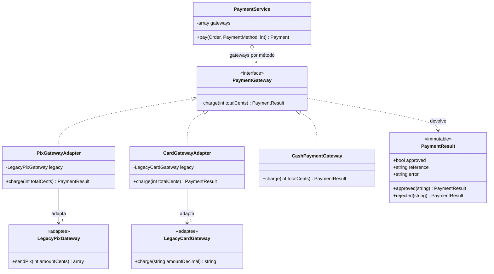

# UML — Adapter (estrutural)

Código: `app/Patterns/Adapter/`. Documentação: [Padrões de projeto — Adapter](../PADROES_DE_PROJETO.md#3-adapter-estrutural).

| Participante GoF | Classe real |
|---|---|
| Target | `PaymentGateway` (interface) |
| Adaptees | `LegacyPixGateway` (`sendPix(int): array`), `LegacyCardGateway` (`charge(string): string`) |
| Adapters | `PixGatewayAdapter`, `CardGatewayAdapter` |
| Client | `PaymentService` |
| Fora do padrão | `CashPaymentGateway` (implementa o Target diretamente), `PaymentResult` (resultado padronizado) |

Cada adapter guarda uma referência ao adaptee, injetada no construtor (associação). Os gateways legados são simuladores locais: não há chamadas de rede.

Voltar: [índice](../README.md)
