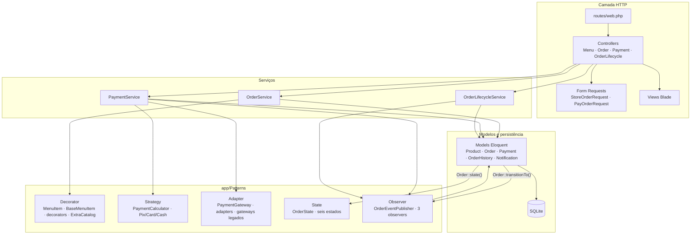

# C4 — Nível 3: componentes da aplicação Laravel

Componentes reais de `app/`. Os cinco padrões GoF estão em `app/Patterns/`, um subdiretório por padrão. As setas indicam dependência de uso.

A composição do `OrderEventPublisher`, do `PaymentCalculator` e dos gateways do `PaymentService` é feita em `app/Providers/AppServiceProvider.php`. Detalhes de cada padrão: [Padrões de projeto](../PADROES_DE_PROJETO.md).

Voltar: [C4 — contêineres](c4-container.md)
