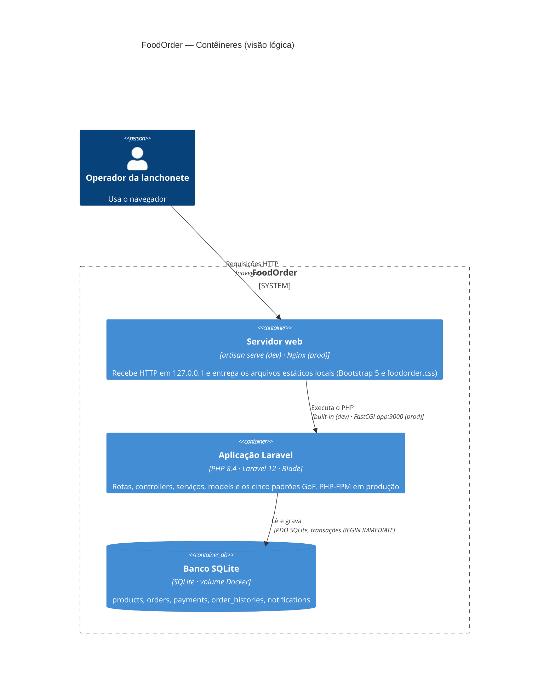

# C4 — Nível 2: contêineres

"Contêiner" aqui é o conceito do C4 Model (uma unidade executável ou um armazenamento de dados), **não** um contêiner Docker. Os padrões GoF **não** são contêineres: são classes dentro da aplicação Laravel.

A topologia varia por ambiente (ver [diagrama de implantação](docker-deployment.md) e [Ambientes Docker](../AMBIENTES_DOCKER.md)):

- **Desenvolvimento:** `php artisan serve` atende HTTP, a aplicação e os assets.
- **Produção:** Nginx serve os arquivos estáticos de `public/` e repassa o PHP via FastCGI ao PHP-FPM.

Voltar: [C4 — contexto](c4-context.md) · Próximo nível: [C4 — componentes](c4-component.md)
