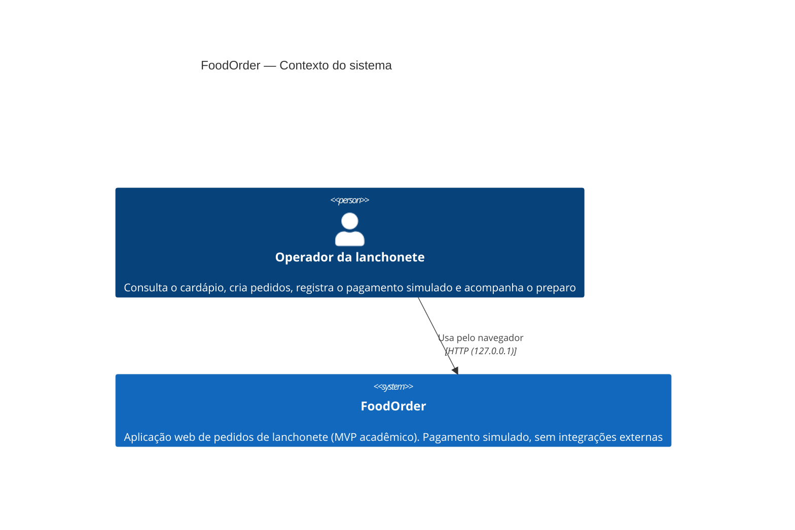

# C4 — Nível 1: contexto do sistema

Mostra o FoodOrder como uma caixa única e quem interage com ele. Há **um único ator operacional**: o operador da lanchonete, que usa o navegador. O FoodOrder **não tem autenticação**, portanto cliente e cozinha **não são usuários do sistema**: são apenas os públicos-alvo das notificações internas gravadas no banco (`notifications.audience` = `customer` ou `kitchen`). Os "gateways" de PIX e cartão são classes simuladoras dentro da própria aplicação; **não** são sistemas financeiros externos.

Observações:

- Cliente e cozinha aparecem apenas como texto de notificação interna (ver [Padrão Observer](../PADROES_DE_PROJETO.md#5-observer-comportamental)); nenhuma mensagem é enviada por e-mail, WhatsApp ou outro canal.
- Os simuladores `LegacyPixGateway` e `LegacyCardGateway` ficam em `app/Patterns/Adapter/` e não fazem chamadas de rede.

Voltar: [índice de diagramas](../README.md) · Próximo nível: [C4 — contêineres](c4-container.md)
