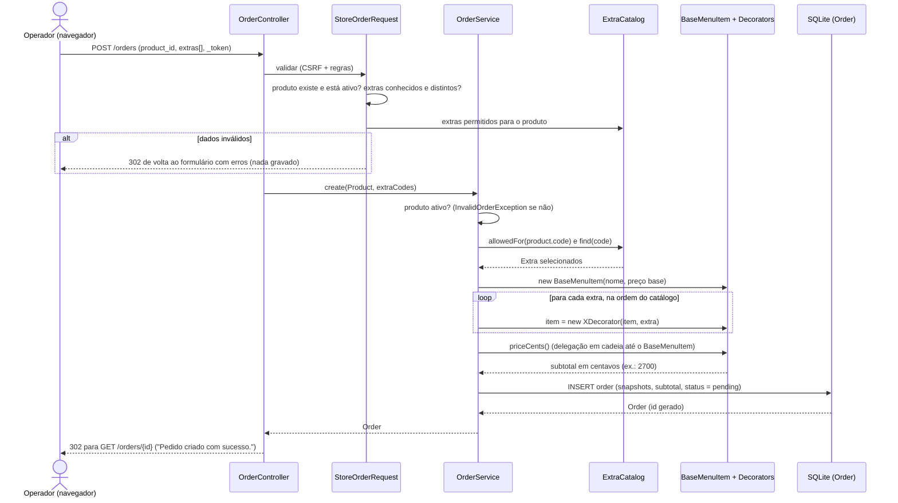

# Sequência — criação de pedido (Decorator)

Fluxo real de `POST /orders` (`OrderController::store` → `OrderService::create`). O subtotal e a descrição vêm da cadeia de decorators; preço e estado enviados pelo navegador nunca são usados (RN09). Os extras são aplicados na **ordem do catálogo** (bacon, queijo, ovo), independentemente da ordem de marcação. Nenhum evento é publicado: criar o pedido não é uma transição (RN08).

Voltar: [índice](../README.md) · Padrão: [Decorator](../PADROES_DE_PROJETO.md#1-decorator-estrutural)
