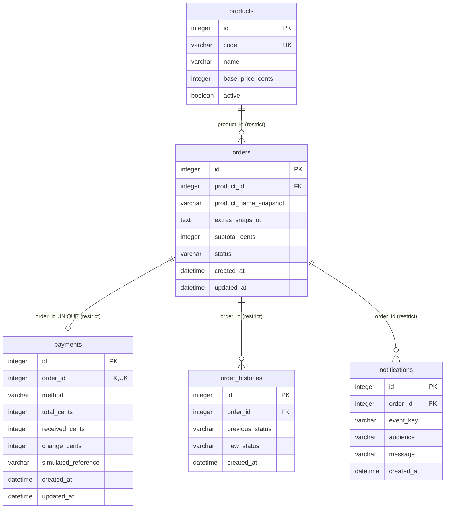

# Diagrama entidade-relacionamento

Baseado nas migrations em `database/migrations/`. A tabela `migrations` do Laravel (controle técnico) não é uma entidade de negócio e não aparece. Não existem usuários, estoque, categorias, carrinho nem integrações financeiras. Dicionário completo: [Modelagem de dados](../MODELAGEM_DE_DADOS.md).

Restrições compostas: `order_histories` tem `UNIQUE (order_id, new_status)`; `notifications` tem `UNIQUE (order_id, event_key, audience)`.

Voltar: [índice](../README.md)
