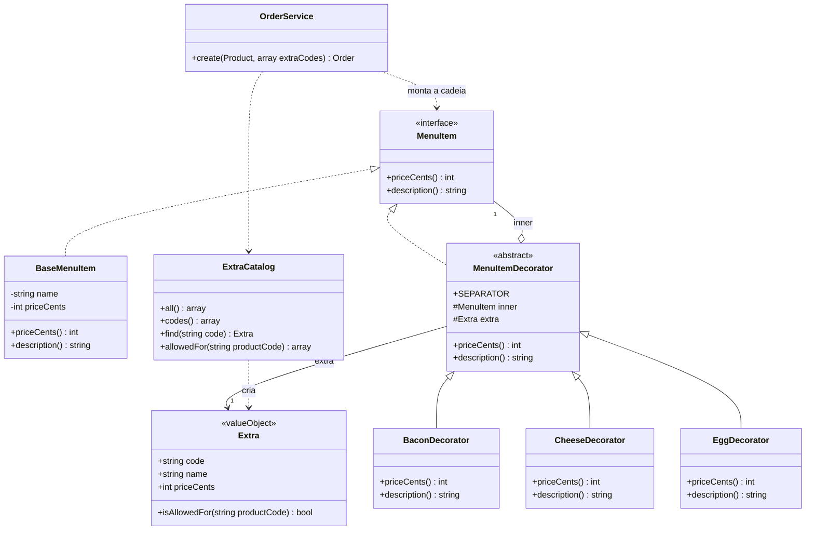

# UML — Decorator (estrutural)

Código: `app/Patterns/Decorator/`. Documentação do padrão: [Padrões de projeto — Decorator](../PADROES_DE_PROJETO.md#1-decorator-estrutural).

| Participante GoF | Classe real |
|---|---|
| Component | `MenuItem` (interface) |
| Concrete Component | `BaseMenuItem` |
| Decorator | `MenuItemDecorator` (classe abstrata) |
| Concrete Decorators | `BaconDecorator`, `CheeseDecorator`, `EggDecorator` |
| Auxiliares (não são participantes) | `Extra` (valor), `ExtraCatalog` (leitura de `config/foodorder.php`) |

O decorator **mantém uma referência** ao `MenuItem` embrulhado, injetada no construtor, e não cria nem destrói esse objeto; por isso a relação é de **agregação** (losango vazio), não de composição.

Voltar: [índice](../README.md)
