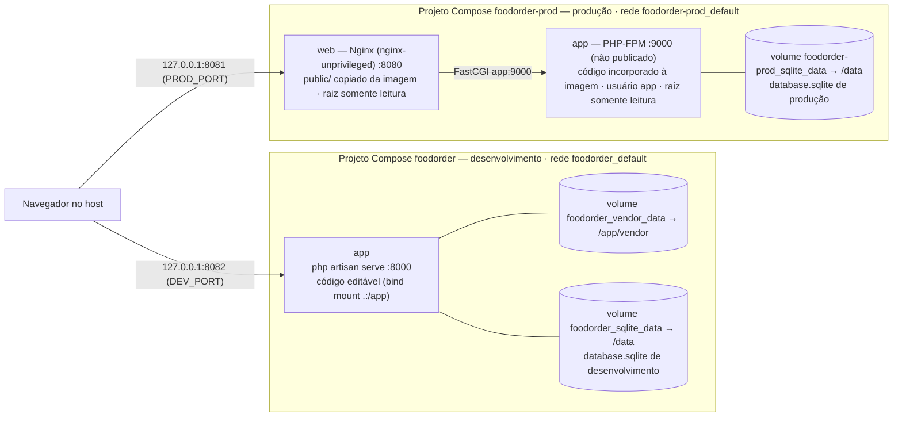

# Implantação — ambientes Docker

Duas stacks Compose **independentes**, que podem rodar ao mesmo tempo. Tudo escuta apenas em `127.0.0.1`. Não há servidor público, domínio nem TLS. Procedimentos: [Ambientes Docker](../AMBIENTES_DOCKER.md).

Valores de porta: em produção `PROD_PORT=8081`; em desenvolvimento o `.env.example` traz `DEV_PORT=8080` (neste ambiente de demonstração o `.env` local usa 8082). Redes, volumes, bancos SQLite e `APP_KEY` são distintos entre as stacks.

Voltar: [índice](../README.md)
