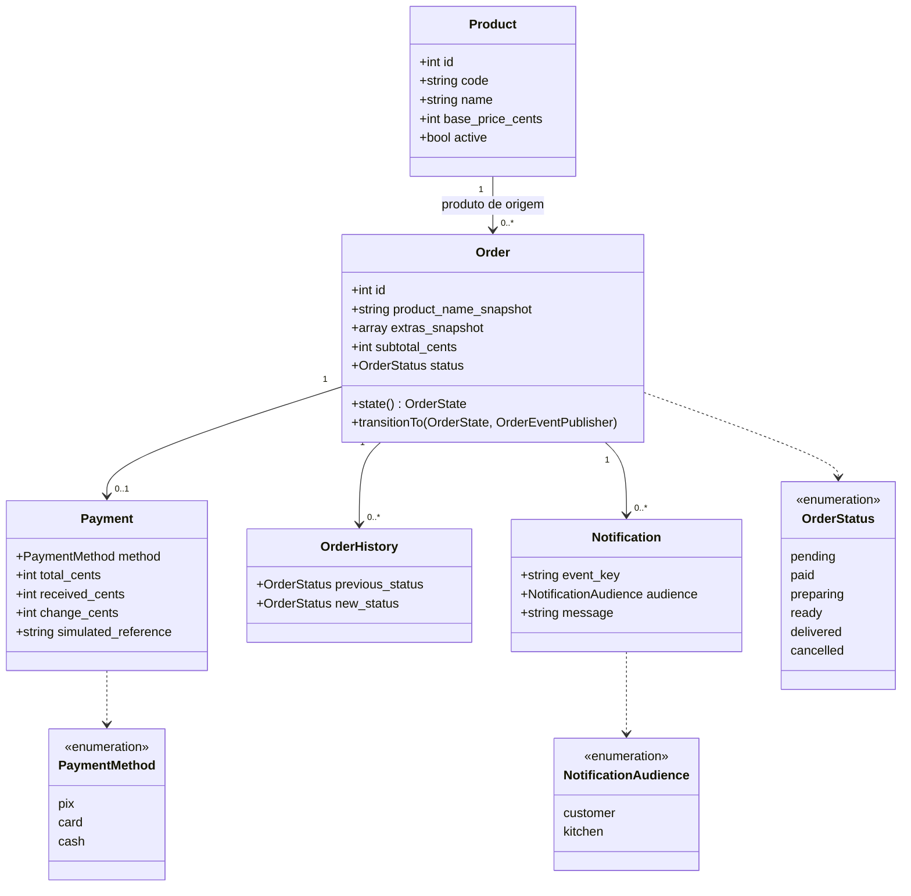

# Modelo de domínio

Entidades persistidas e os conceitos de domínio que as cercam. Os estados e os extras não são entidades persistidas independentes: o estado é uma coluna (`orders.status`) e os extras são um snapshot JSON em `orders.extras_snapshot`. Detalhes de tabelas: [Modelagem de dados](../MODELAGEM_DE_DADOS.md).

Voltar: [índice](../README.md)
