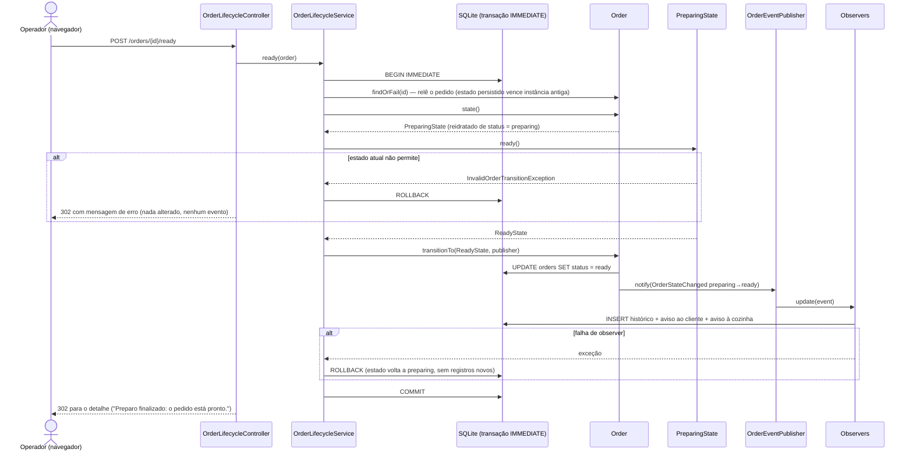

# Sequência — ciclo de vida (exemplo `preparing → ready`)

Fluxo real de `POST /orders/{order}/ready` (`OrderLifecycleController::ready` → `OrderLifecycleService::ready`). As demais ações (`start`, `deliver`, `cancel`) seguem exatamente o mesmo caminho, trocando apenas a operação do State.

Voltar: [índice](../README.md) · Padrões: [State](../PADROES_DE_PROJETO.md#4-state-comportamental), [Observer](../PADROES_DE_PROJETO.md#5-observer-comportamental)
