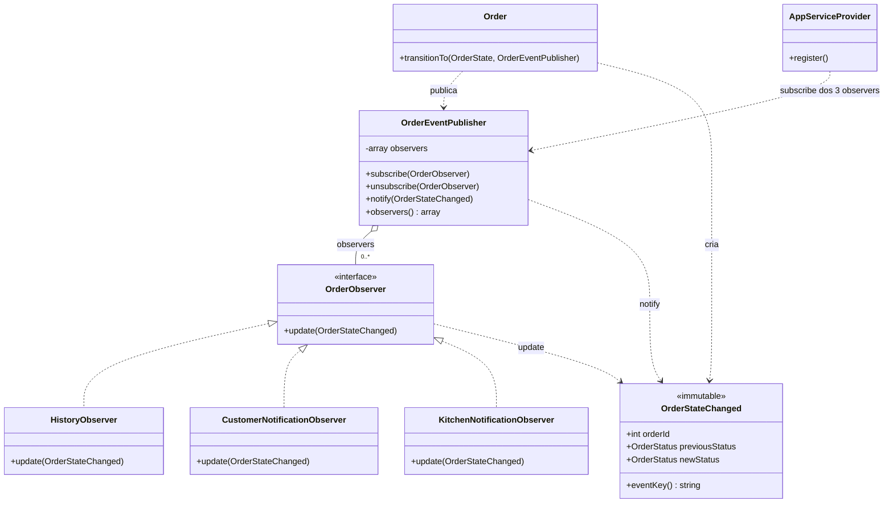

# UML — Observer (comportamental)

Código: `app/Patterns/Observer/`. Documentação: [Padrões de projeto — Observer](../PADROES_DE_PROJETO.md#5-observer-comportamental).

| Participante GoF | Classe real |
|---|---|
| Subject | `OrderEventPublisher` |
| Observer | `OrderObserver` (interface) |
| Concrete Observers | `HistoryObserver`, `CustomerNotificationObserver`, `KitchenNotificationObserver` |
| Evento (objeto de notificação) | `OrderStateChanged` (imutável) |

O publisher guarda as referências dos observadores (agregação) e **não conhece as classes concretas**: quem os inscreve é `AppServiceProvider`. `Order::transitionTo()` recebe o publisher como parâmetro e publica um evento por transição.

Voltar: [índice](../README.md)
