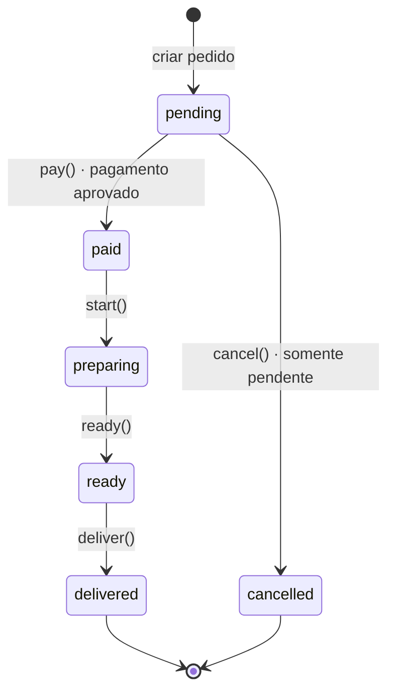

# Diagrama de estados do pedido

Máquina de estados implementada pelas classes de `app/Patterns/State/` (ver [padrão State](../PADROES_DE_PROJETO.md#4-state-comportamental)). As operações são `pay`, `start`, `ready`, `deliver` e `cancel`.

- `paid` só é alcançado com **pagamento aprovado**; se o pagamento é rejeitado, o pedido continua `pending` e pode tentar de novo.
- Só um pedido `pending` pode ser cancelado.
- `delivered` e `cancelled` são **terminais**: não há retorno nem reabertura.
- A criação do pedido (`[*] → pending`) não é uma transição publicada: não gera histórico nem notificação.

Voltar: [índice](../README.md)
