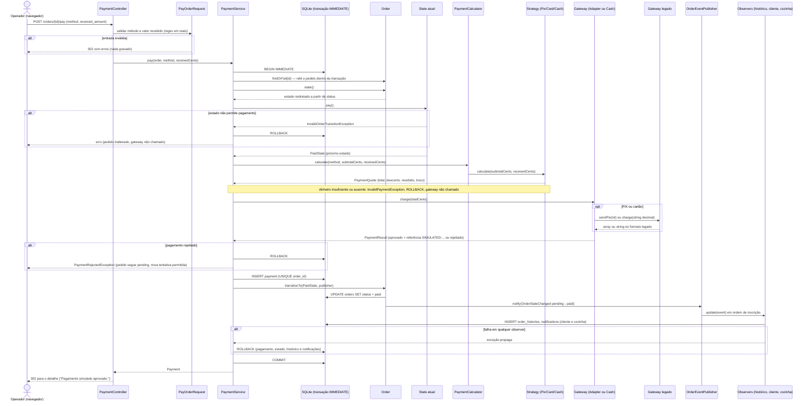

# Sequência — pagamento (Strategy + Adapter + State + Observer)

Fluxo real de `POST /orders/{order}/pay` (`PaymentController::store` → `PaymentService::pay`). Utiliza o subtotal persistido, produzido antes pelo **Decorator**. Toda a operação ocorre em **uma transação** SQLite (`BEGIN IMMEDIATE`, configurado em `config/database.php`). A ordem é deliberada: o State valida antes de qualquer cálculo ou cobrança simulada, e o gateway é chamado antes de gravar o pagamento.

Voltar: [índice](../README.md) · Padrões: [Strategy](../PADROES_DE_PROJETO.md#2-strategy-comportamental), [Adapter](../PADROES_DE_PROJETO.md#3-adapter-estrutural), [State](../PADROES_DE_PROJETO.md#4-state-comportamental), [Observer](../PADROES_DE_PROJETO.md#5-observer-comportamental)
