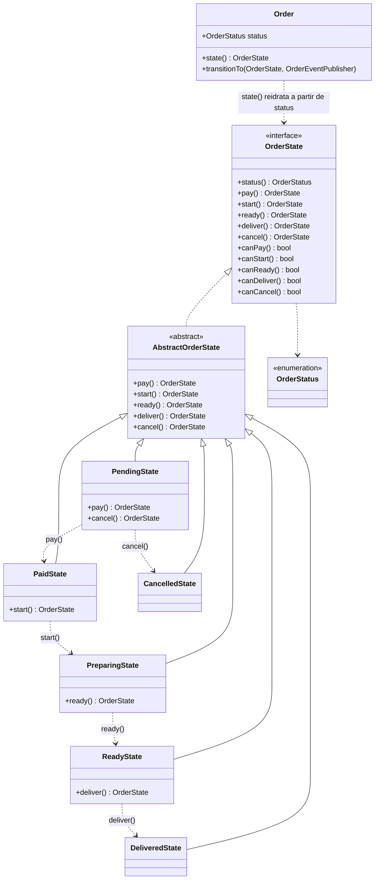

# UML — State (comportamental)

Código: `app/Patterns/State/` e `app/Models/Order.php`. Documentação: [Padrões de projeto — State](../PADROES_DE_PROJETO.md#4-state-comportamental).

| Participante GoF | Classe real |
|---|---|
| Context | `Order` (`state()` e `transitionTo()`) |
| State | `OrderState` (interface) |
| Classe auxiliar abstrata | `AbstractOrderState` (rejeita tudo por padrão) |
| Concrete States | `PendingState`, `PaidState`, `PreparingState`, `ReadyState`, `DeliveredState`, `CancelledState` |
| Valor persistido (não é estado GoF) | `OrderStatus` (enum) |

As setas tracejadas entre estados concretos indicam **qual estado cada operação devolve** (as cinco transições válidas). `DeliveredState` e `CancelledState` não sobrescrevem nenhuma operação.

Voltar: [índice](../README.md)
