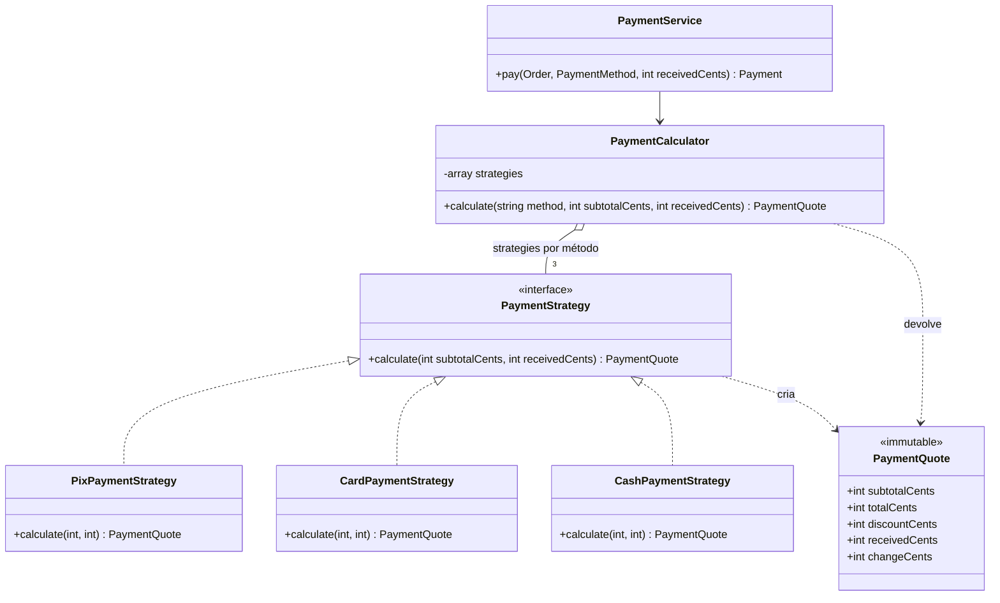

# UML — Strategy (comportamental)

Código: `app/Patterns/Strategy/`. Documentação: [Padrões de projeto — Strategy](../PADROES_DE_PROJETO.md#2-strategy-comportamental).

| Participante GoF | Classe real |
|---|---|
| Strategy | `PaymentStrategy` (interface) |
| Concrete Strategies | `PixPaymentStrategy`, `CardPaymentStrategy`, `CashPaymentStrategy` |
| Context | `PaymentCalculator` |
| Objeto de resultado (não é estratégia) | `PaymentQuote` |
| Cliente do Context | `PaymentService` |

O `PaymentCalculator` recebe o mapa `método → estratégia` no construtor (montado em `AppServiceProvider`) e apenas delega: agregação de estratégias que existem independentemente dele.

Voltar: [índice](../README.md)
