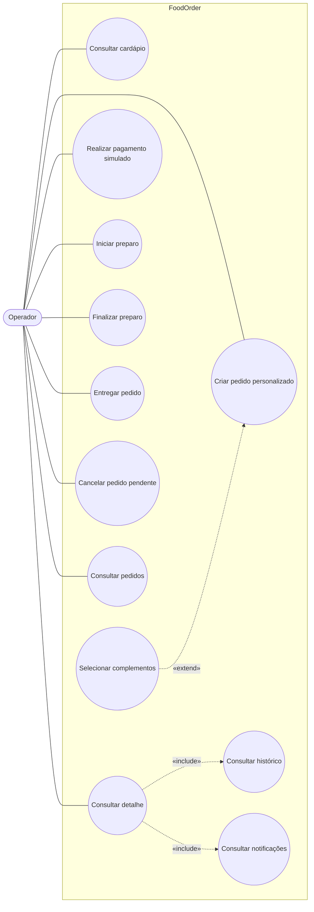

# Casos de uso

O único ator é o **Operador** (não há autenticação). Mermaid não possui diagrama de casos de uso UML nativo; este diagrama usa a notação de fluxo com elipses (casos de uso) e setas tracejadas rotuladas `«include»`/`«extend»`. Foi revisado manualmente quanto à semântica UML.

- `«extend»` em *Selecionar complementos*: é opcional e só ocorre ao criar o pedido.
- `«include»` em *Consultar detalhe*: a página de detalhe sempre exibe histórico e notificações.
- *Pagamento* e *cancelamento* só estão disponíveis em pedidos `pending`; preparo, finalização e entrega seguem o estado atual (ver [diagrama de estados](order-state.md)).

Mapeamento para rotas: ver [Requisitos e regras de negócio](../REQUISITOS_E_REGRAS_DE_NEGOCIO.md) e [Arquitetura](../ARQUITETURA.md).

Voltar: [índice](../README.md)
